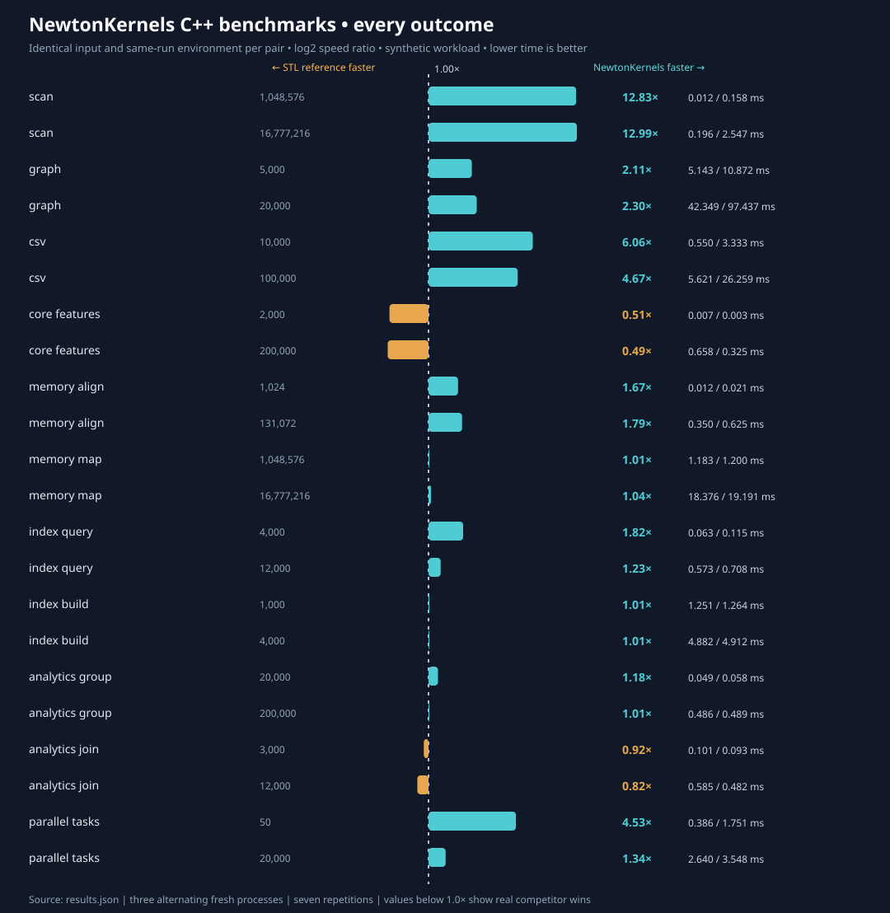

# All eight modules — same-run GitHub Actions comparison

**Run:** [41489511384](https://github.com/NewtonRedRing/newton-kernels/actions/runs/41489511384), completed successfully on 2026-11-02.
**Environment:** AMD EPYC 9V74 80-Core Processor · 4 visible CPUs · Ubuntu 24.04 · GCC 13.3 C++20 Release.
**Design:** 22 paired cases (six established-comparator workloads and 16 independently written C++ standard-library references). Fixed seeds, identical workloads/results and 3 alternating process runs × 7 warm repetitions per process.

| Kernel / operation | Size | NewtonKernels | C++ comparator | Comparator time | Ratio | Faster |
|---|---:|---:|---|---:|---:|---|
| scan | 1,048,576 | 0.01231 ms | stl | 0.15795 ms | 12.83× | Newton |
| scan | 16,777,216 | 0.19610 ms | stl | 2.54721 ms | 12.99× | Newton |
| graph | 5,000 | 5.14280 ms | boost | 10.87155 ms | 2.11× | Newton |
| graph | 20,000 | 42.34930 ms | boost | 97.43717 ms | 2.30× | Newton |
| csv | 10,000 | 0.54976 ms | vince | 3.33333 ms | 6.06× | Newton |
| csv | 100,000 | 5.62050 ms | vince | 26.25875 ms | 4.67× | Newton |
| core_features | 2,000 | 0.00663 ms | stl | 0.00337 ms | 0.51× | Comparator |
| core_features | 200,000 | 0.65807 ms | stl | 0.32496 ms | 0.49× | Comparator |
| memory_align | 1,024 | 0.01241 ms | stl | 0.02067 ms | 1.67× | Newton |
| memory_align | 131,072 | 0.34982 ms | stl | 0.62490 ms | 1.79× | Newton |
| memory_map | 1,048,576 | 1.18312 ms | stl | 1.19979 ms | 1.01× | Within 2% (descriptive) |
| memory_map | 16,777,216 | 18.37626 ms | stl | 19.19106 ms | 1.04× | Newton |
| index_query | 4,000 | 0.06299 ms | stl | 0.11456 ms | 1.82× | Newton |
| index_query | 12,000 | 0.57347 ms | stl | 0.70752 ms | 1.23× | Newton |
| index_build | 1,000 | 1.25106 ms | stl | 1.26395 ms | 1.01× | Within 2% (descriptive) |
| index_build | 4,000 | 4.88235 ms | stl | 4.91163 ms | 1.01× | Within 2% (descriptive) |
| analytics_group | 20,000 | 0.04889 ms | stl | 0.05758 ms | 1.18× | Newton |
| analytics_group | 200,000 | 0.48607 ms | stl | 0.48890 ms | 1.01× | Within 2% (descriptive) |
| analytics_join | 3,000 | 0.10093 ms | stl | 0.09304 ms | 0.92× | Comparator |
| analytics_join | 12,000 | 0.58526 ms | stl | 0.48222 ms | 0.82× | Comparator |
| parallel_tasks | 50 | 0.38628 ms | stl | 1.75065 ms | 4.53× | Newton |
| parallel_tasks | 20,000 | 2.63959 ms | stl | 3.54793 ms | 1.34× | Newton |

## Interpretation

All 22 cases passed matching digest, item count, input size and per-run determinism checks. Ratio = comparator / Newton; ratios below 1× mean Newton is slower.
The `stl` competitors in the five-module extension are *independently written C++ reference implementations*, not third-party performance libraries. In particular, the group-by baseline pre-reserves its map, the join comparator uses an unordered_map of vectors, and the parallel baseline launches batches of four `std::async` tasks versus a persistent four-worker Newton executor.
Correct output on these fixtures is not a formal guarantee of feature-equivalence, and the 2% display tie rule is not a statistical significance test.
Peak RSS, process CPU usage, page faults and context switches (where captured) cover entire benchmark processes, not individual library memory usage.
No calibrated bare-metal frequency control, cache-miss counters, energy measurements, allocation tracing, production-data throughput or broad competing-library feature coverage is claimed.
This report was derived from the **same successful workflow** even though classic and extended cases used different compiled executable files. Both sets record matching host CPU, OS, compiler, affinity and virtualization metadata; their binary SHA256 hashes remain separately recorded in `results.json`.

## Reproduce

- [Complete raw results with all process samples](results.json)
- [Classic benchmark raw process samples](classic-results.json)
- [Five-module benchmark raw process samples](extended-results.json)
- [Original C++ competitors and commands](../../competitors/README.md)
- [Official successful Actions run and downloadable artifacts](https://github.com/NewtonRedRing/newton-kernels/actions/runs/41489511384)

A previous local VM campaign is retained for independent replication. **Never combine absolute timings across those machines.**
