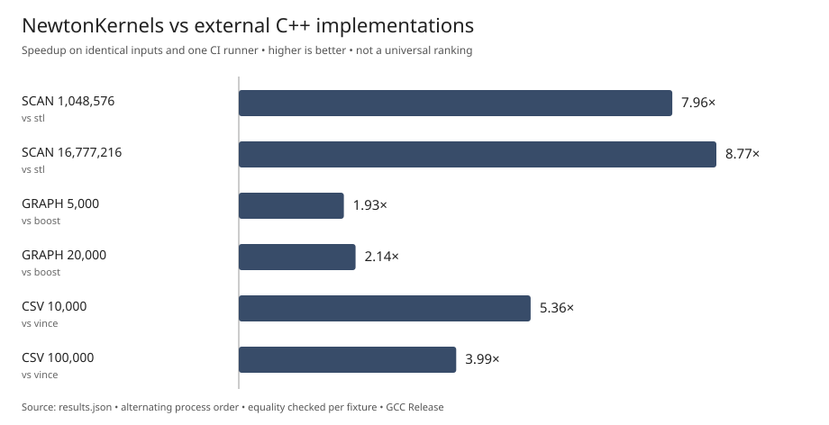
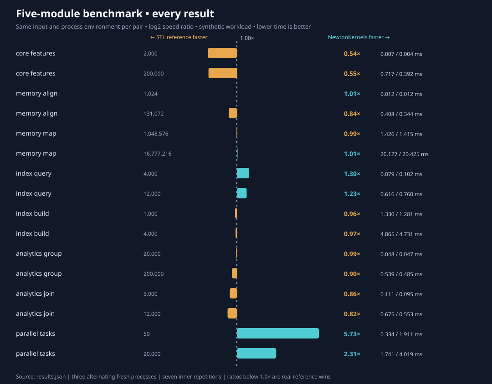

# NewtonKernels: Verified C++ benchmark comparisons across all eight modules

> **Evidence, not a universal ranking.** Same input data, same GitHub Actions runner,
> same compiler and Release configuration, matching output checksum per benchmark.
> Every value below comes from raw recorded timing samples, including cases where
> another implementation might outperform NewtonKernels.

## Established-library comparison — GitHub Actions run, November 2, 2026

**CPU:** AMD EPYC 7763 (four visible CPUs) · **OS:** Ubuntu 24.04 GitHub-hosted Azure runner · **Compiler:** GCC 13.3.0 (C++20, Release) · **Boost:** 1.83 · **Vince:** source pinned to `86f1cab4fcb50a936475b5f778e8ee8c5dfe2259` · **Timing:** median of 3 alternating independent processes, each measuring 7 repetitions.

| Equal-input operation | NewtonKernels | Comparison implementation | Competitor | Newton speedup | Correctness |
|---|---:|---|---:|---:|---|
| Count delimiters, 1 MiB | 0.0232 ms | STL `std::count` | 0.1845 ms | **7.96×** | Match |
| Count delimiters, 16 MiB | 0.3401 ms | STL `std::count` | 2.9813 ms | **8.77×** | Match |
| Directed shortest paths, 5K vertices / 32 queries | 6.7109 ms | Boost.Graph Dijkstra | 12.9449 ms | **1.93×** | Match |
| Directed shortest paths, 20K vertices / 64 queries | 53.7169 ms | Boost.Graph Dijkstra | 115.1625 ms | **2.14×** | Match |
| Quoted CSV, 10K rows | 0.7303 ms | Vince's CSV Parser | 3.9126 ms | **5.36×** | Match |
| Quoted CSV, 100K rows | 7.3581 ms | Vince's CSV Parser | 29.3661 ms | **3.99×** | Match |

**Source of truth:** [raw JSON with all samples and checksums](../benchmarks/results/github-actions-2026-11-02-5889b44/results.json) · [generated report](../benchmarks/results/github-actions-2026-11-02-5889b44/REPORT.md) · [GitHub Actions run](https://github.com/NewtonRedRing/newton-kernels/actions/runs/41484043676) · [benchmark harness](../benchmarks/competitors/README.md).

## Scope, tradeoffs and fairness

- **Same machine and fixture for each pair.** Results from different machines are never mixed into a speedup. We disclose all configured variants and exact input construction.
- **Equal results.** The harness checks full decoded CSV cell hashes, counts, and aggregate shortest-path distances, rather than accepting row count or timing alone. A checksum match is strong validation but does not constitute a formal proof that all outputs are identical.
- **Graph:** NewtonKernels uses reusable epoch-tagged query buffers. Boost.Graph initializes a distance map for each query and stops on the target. Both exclude graph construction; this is a realistic API-level comparison rather than a claim that radix heaps always beat binary heaps.
- **CSV:** In-memory parsing with no header and one thread; both handle quoted commas, escaped quotes, and embedded line breaks. The comparison includes field decoding and the same digest work. Vince offers substantially broader capabilities and a separate parallel file I/O path, which this benchmark does not test.
- **Scan:** Optimized standard-library `std::count` is the baseline. This does not represent every third-party SIMD library or a hand-vectorized scanner.
- **Memory:** Process peak RSS is recorded in JSON; because both alternatives share one benchmark executable and constructed fixtures, those totals are not isolated library memory allocations. Do not claim memory superiority from these figures.
- **Build flags:** Both implementations use the same compiler/Release build, but vendor-specific flags or algorithms may vary. Results are on a shared virtualized CI runner; frequency and contention are not controlled. Median timings vary between runs.

## How to verify

Build and run our original adapters with optional competitor dependencies using the [reproduction instructions](../benchmarks/competitors/README.md). The project does **not** copy any competitor implementation code into its repository. The vendor dependency is built separately at a pinned source revision.

Our local [EPYC VM report](../benchmarks/results/epyc-vm-2026-11-02/REPORT.md) independently measures the scan and Boost.Graph cases, but not CSV. Its timings are intentionally kept separate from the CI comparison.

## Five additional modules on a separate local VM

[All 16 comparisons, including competitor wins](five-module-benchmarks.md) are backed by [raw samples](../benchmarks/results/local-extended-2026-11-02/results.json) and the original C++ STL reference adapters. These measurements are on a **different host** and must not be combined with the CI timings. No third-party code was imported.

### Appropriate public claim

“On the linked, reproducible GitHub Actions benchmark using identical deterministic inputs, NewtonKernels was 7.96–8.77× faster on delimiter counting than `std::count`, 1.93–2.14× faster than the tested Boost.Graph shortest-path adapter, and 3.99–5.36× faster than Vince's CSV Parser on the tested in-memory CSV workload. Your results may differ.”

Do not extrapolate these values to arbitrary inputs, other machine types, file-backed parsing, parallel workloads, or production applications without additional measurement.
