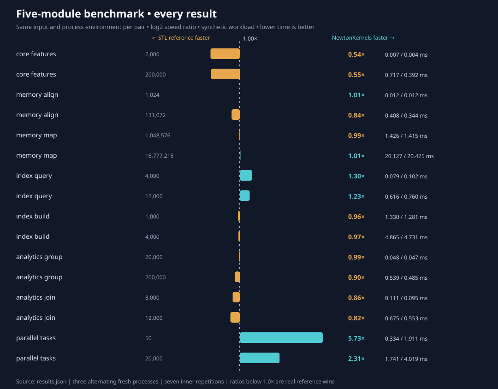

# Five-module performance comparison — verified local baseline campaign

> Same-machine measurements, not production speed guarantees or a cross-machine leaderboard.

**Environment:** AMD EPYC 9V74 80-Core Processor · Linux-6.18.57-x86_64-with-glibc2.41 · c++ (Debian 14.2.0-19) 14.2.0.
**Scope:** CPU feature detection, aligned allocation and mapped file reads, positional index construction and queries, grouping and joining, and parallel task dispatch.

## Every outcome

| Operation | Size | Newton median | Standard C++ reference median | Ratio | Outcome |
|---|---:|---:|---:|---:|---|
| `core_features` | 2,000 | 0.00708 ms | 0.00382 ms | 0.54× | Reference faster |
| `core_features` | 200,000 | 0.71740 ms | 0.39194 ms | 0.55× | Reference faster |
| `memory_align` | 1,024 | 0.01204 ms | 0.01213 ms | 1.01× | Approximately tied (<2%) |
| `memory_align` | 131,072 | 0.40833 ms | 0.34363 ms | 0.84× | Reference faster |
| `memory_map` | 1,048,576 | 1.42637 ms | 1.41509 ms | 0.99× | Approximately tied (<2%) |
| `memory_map` | 16,777,216 | 20.12739 ms | 20.42480 ms | 1.01× | Approximately tied (<2%) |
| `index_query` | 4,000 | 0.07853 ms | 0.10189 ms | 1.30× | Newton faster |
| `index_query` | 12,000 | 0.61649 ms | 0.75952 ms | 1.23× | Newton faster |
| `index_build` | 1,000 | 1.33034 ms | 1.28051 ms | 0.96× | Reference faster |
| `index_build` | 4,000 | 4.86476 ms | 4.73125 ms | 0.97× | Reference faster |
| `analytics_group` | 20,000 | 0.04803 ms | 0.04735 ms | 0.99× | Approximately tied (<2%) |
| `analytics_group` | 200,000 | 0.53890 ms | 0.48471 ms | 0.90× | Reference faster |
| `analytics_join` | 3,000 | 0.11071 ms | 0.09536 ms | 0.86× | Reference faster |
| `analytics_join` | 12,000 | 0.67483 ms | 0.55339 ms | 0.82× | Reference faster |
| `parallel_tasks` | 50 | 0.33371 ms | 1.91064 ms | 5.73× | Newton faster |
| `parallel_tasks` | 20,000 | 1.74060 ms | 4.01866 ms | 2.31× | Newton faster |

**Interpretation:** Ratio = competitor / Newton. A value below 1× means NewtonKernels is **slower**. A difference below 2% is recorded as approximately tied for display only; no statistical equivalence is asserted.

## Provenance and reproducibility

- [Raw full results, individual process medians, full in-process min/max, checksums and process resource counters](../benchmarks/results/local-extended-2026-11-02/results.json).
- [Automatically generated original campaign report](../benchmarks/results/local-extended-2026-11-02/REPORT.md).
- [Original benchmark adapters](../benchmarks/competitors/extended.cpp) and [runner](../benchmarks/competitors/run_extended.py).
- [Standalone comparison SVG](../benchmarks/results/local-extended-2026-11-02/comparison.svg).
- Three independent alternating processes per implementation, seven warmed repetitions per process. Same deterministic fixture, compiler and environment for both sides of every pair.
- Memory RSS, user/system CPU time, minor/major faults and voluntary/involuntary context switches are whole-process totals, including preparation. They are **not attributable solely to a library**.
- CPU governor inaccessible; virtualized environment with scheduling/frequency uncertainty. Tiny sub-millisecond differences are especially noisy.
- Hardware counters, allocation tracing, energy, production data, persistent index features, cold file cache, and fully matched higher-level feature breadth are not measured.

## Comparability boundaries

The reference baselines are original adapters built on standard C++ facilities rather than imported competitors' source code. Identical outputs are verified for defined kernels, but the libraries do not have equal feature breadth. `index_build` includes storing token positions in both indexes; the comparison is not against a document-ID-only index. `parallel_tasks` compares a persistent four-worker executor with four simultaneous `std::async` tasks per wave. `memory_map` compares a mapped file with a buffered stream and both process the full file contents, not just opening a handle.

These results were recorded on a **different host** from the published six-case CI campaign; do not compare absolute times between the two campaigns or combine their scores.

## Earlier established competitor campaign

The [GitHub Actions comparison](benchmark-dashboard.md) separately measures Boost.Graph, Vince's CSV Parser, and the standard-library delimiter count on the same CI host. The [interactive website](../showcase/index.html) provides an explicit campaign selector and does not merge timings from different machines.
